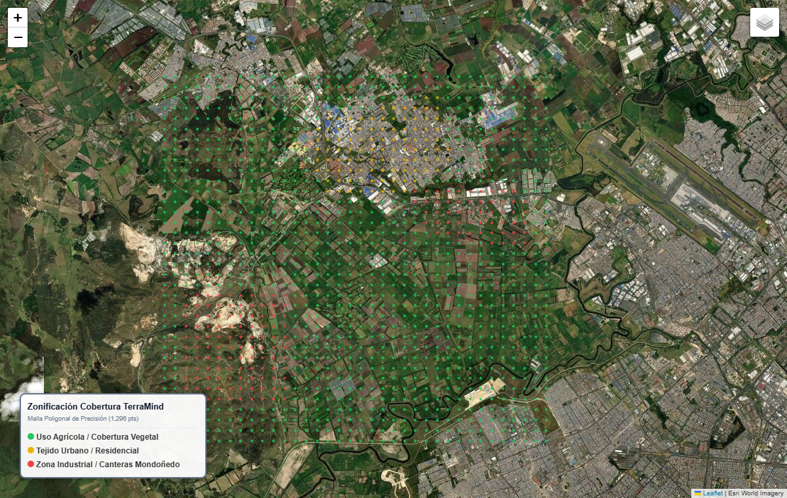
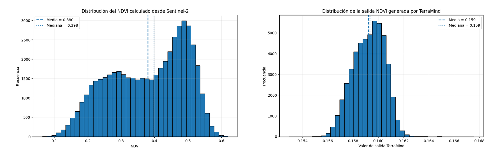
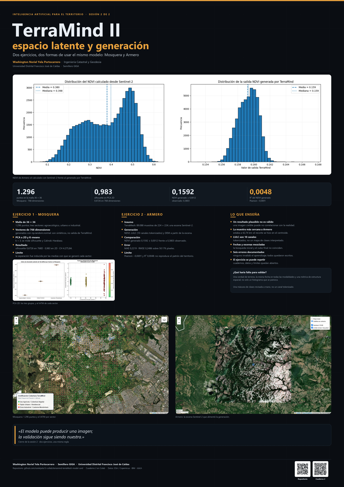

# TerraMind: Mosquera y Armero

**Dos ejercicios, dos formas de usar el mismo modelo: espacio latente simulado y generación multimodal.**

Sesión 2 de la serie *Inteligencia Artificial para el Territorio* · Semillero GIGA · Universidad Distrital Francisco José de Caldas.

[](https://colab.research.google.com/drive/1lzwYfg4Y5HRh4IkVhSZFjW4zGXAz6cqf?usp=sharing)

---

## Qué hay aquí

Dos cuadernos que usan TerraMind de maneras distintas y comparan los resultados:

1. **Mosquera** — se construye un espacio latente simulado de 1.296 puntos y 768 dimensiones, se reduce con PCA y se mide cómo se separan tres sectores.
2. **Armero** — se le pide al modelo generativo que produzca NDVI, LULC y DEM a partir de una imagen Sentinel-2, y se compara el NDVI generado con el calculado.

El contraste es el tema: **generar no es observar**. Un resultado plausible no es un resultado válido.

## Ejercicio 1 · Mosquera

| Aspecto | Detalle |
|---------|---------|
| Malla | 36 × 36 = **1.296 puntos** |
| Vectores | **768 dimensiones** generados con `np.random.normal` |
| Reducción | PCA a 2D |
| Agrupamiento | K-means con k = 3 |
| Silhouette (768D) | **0,6726** |
| Silhouette (PCA 2D) | **0,983** |
| Calinski-Harabasz | **4.275,84** |
| IATM por sector | agroecológico ≈ 0,00 · urbano ≈ 0,46 · industrial ≈ 0,99 |

**Límite:** la separación fue inducida por las medias distintas con las que se generó cada sector. No demuestra que TerraMind separe coberturas reales.



*Mosquera: 1.296 puntos y el IATM por sector.*

## Ejercicio 2 · Armero

| Aspecto | Detalle |
|---------|---------|
| Insumo | TerraMesh: **89.088 muestras** de 224 × 224; una escena Sentinel-2 L2A de 12 bandas |
| Generación | NDVI, LULC (10 canales tokenizados) y DEM |
| NDVI generado | **0,1592 ± 0,0012** |
| NDVI observado | **0,3803** |
| MAE | **0,2219** |
| RMSE | **0,2486** |
| Pearson | **−0,0691** |
| R² | **0,0048** |
| Píxeles comparados | 50.176 |

**Límite:** el NDVI generado colapsa en una constante y no reproduce el patrón del territorio. La muestra de TerraMesh más cercana a Armero estaba a **42,74 km**; además, la búsqueda inicial y el cubo final no son la misma fecha y se usó una sola escena por análisis. El LULC son 10 canales tokenizados, no un mapa de clases interpretado.



*NDVI de Armero: el calculado con Sentinel-2 frente al generado por TerraMind.*

## Cómo ejecutarlo

### En Colab

- [Cuaderno 1 · Mosquera (espacio latente)](https://colab.research.google.com/drive/1lzwYfg4Y5HRh4IkVhSZFjW4zGXAz6cqf?usp=sharing)
- Cuaderno 2 · Armero (generación multimodal): `notebooks/02_armero_generacion_multimodal.ipynb`

### En local

```bash
py -m venv .venv
.venv\Scripts\activate        # Windows
pip install -r requirements.txt
jupyter lab notebooks/
```

Los cuadernos se ejecutaron en Colab con GPU T4. Algunas versiones están fijadas (`diffusers==0.30.0`, `transformers==4.45.2`, `tokenizers==0.20.1`, `zarr==2.18.0`) porque TerraMind es sensible a los cambios de esas librerías. La celda de exportación usa `google.colab.files`; en local se puede omitir o reemplazar por una escritura directa con `rasterio`.

## Estructura

```
.
├── notebooks/
│   ├── 01_mosquera_espacio_latente.ipynb
│   └── 02_armero_generacion_multimodal.ipynb
├── exports/
│   ├── 01_mosquera_colab.pdf
│   └── 02_armero_colab.pdf
├── docs/
│   ├── poster.jpg / poster.pdf
│   ├── figura_mosquera.png
│   └── figura_ndvi.png
├── requirements.txt
├── CITATION.cff
└── LICENSE
```

## Póster

[](docs/poster.pdf)

A2 (42 × 59,4 cm), 3508 × 4961 px, 212 ppp. Incluye códigos QR al repositorio y al cuaderno.

## Datos, modelos y créditos

- **TerraMind** — IBM Research, ESA Φ-lab, Forschungszentrum Jülich. Apache 2.0.
- **TerraMesh** — CC BY-SA 4.0.
- **Sentinel-2** — ESA / Copernicus.
- **Catálogo STAC** — Microsoft Planetary Computer.
- **Documentación del modelo y del dataset** — [terramind-terraMesh-model-card](https://github.com/norielyela13-collab/terramind-terraMesh-model-card).

## Licencia y cita

El código de este repositorio se publica con licencia **MIT** (ver `LICENSE`). Los datos, los pesos y las imágenes de terceros conservan sus licencias originales.

```bibtex
@misc{yela2026terramindmosquera,
  author = {Yela Portocarrero, Washington Noriel},
  title  = {TerraMind: espacio latente en Mosquera y generación multimodal en Armero},
  year   = {2026},
  url    = {https://github.com/norielyela13-collab/terramind-mosquera-armero}
}
```
